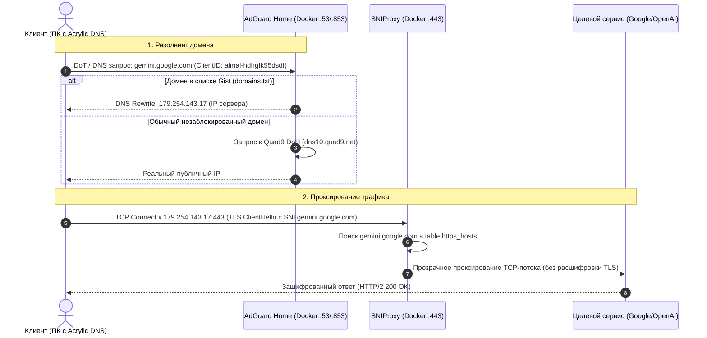

# Архитектурный отчёт: Серверный Smart DNS (AdGuard Home + SNIProxy)

> [!NOTE]  
> **Назначение документа:** Этот отчёт содержит полную техническую спецификацию серверной части Smart DNS, развёрнутой на хосте `179.254.143.17`. Он составлен для разработчиков и агентов клиентского проекта [acrylic-dns-unlock](https://github.com/fdoo24/acrylic-dns-unlock) (`C:\Users\almal\Documents\Qoder\2026-11-12\e323b1f2\repo\acrylic-dns-unlock`), чтобы синхронизировать клиентскую логику с серверной без необходимости повторного исследования.

---

## 1. Сводные параметры сервера

| Параметр | Значение | Описание |
| :--- | :--- | :--- |
| **Хост / IP** | `179.254.143.17` | Внешний IPv4 адрес сервера |
| **Hostname** | `83643.h2.nexus` | Системное имя машины |
| **ОС / Ядро** | `Ubuntu 22.04.5 LTS` (Linux 5.15.0-203-generic x86_64) | Базовый дистрибутив |
| **Домен DuckDNS** | `videohub25.duckdns.org` | Используется для TLS/SSL (DoT, DoQ, HTTPS) |
| **SSL-сертификаты** | `/root/cert/videohub25.duckdns.org/` | Let's Encrypt (`fullchain.pem`, `privkey.pem`), автопродление через `acme.sh` |
| **Папка проекта** | `/root/smart-dns/` | Все compose-файлы, конфиги и скрипты |

---

## 2. Архитектура и принцип работы Smart DNS

Схема предназначена для обхода региональных блокировок (Gemini, Google AI Studio, ChatGPT, Claude, Spotify, OpenRouter) без необходимости держать включённый VPN на клиентах:



---

## 3. Docker-контейнеры и сетевые порты

Контейнеры описаны в `/root/smart-dns/docker-compose.yml`:

```yaml
services:
  sniproxy:
    image: ubuntu:24.04
    container_name: smart-dns-sniproxy
    restart: unless-stopped
    ports:
      - "179.254.143.17:443:443/tcp"
    command: /bin/sh -c "apt-get update && DEBIAN_FRONTEND=noninteractive apt-get install -y sniproxy && sniproxy -f -c /etc/my-sniproxy.conf"
    volumes:
      - ./sniproxy.conf:/etc/my-sniproxy.conf:ro

  adguard:
    image: adguard/adguardhome
    container_name: smart-dns-adguard
    restart: unless-stopped
    ports:
      - "179.254.143.17:53:53/udp"
      - "179.254.143.17:53:53/tcp"
      - "179.254.143.17:853:853/tcp"
      - "179.254.143.17:853:853/udp"
      - "3000:3000/tcp"
    volumes:
      - ./ag-work:/opt/adguardhome/work
      - ./ag-conf:/opt/adguardhome/conf
      - /root/cert/videohub25.duckdns.org:/opt/adguardhome/ssl:ro
    depends_on:
      - sniproxy
```

### Таблица портов Smart DNS:
* **`179.254.143.17:53` (UDP/TCP):** Стандартный DNS.
* **`179.254.143.17:853` (TCP/UDP):** DNS-over-TLS (DoT) и DNS-over-QUIC (DoQ).
* **`0.0.0.0:3000` (TCP):** Веб-панель управления AdGuard Home (пользователь: `fdfd`).
* **`179.254.143.17:443` (TCP):** SNIProxy (принимает перенаправленный HTTPS-трафик).

---

## 4. Конфигурация AdGuard Home (`AdGuardHome.yaml`)

Файл расположен в `/root/smart-dns/ag-conf/AdGuardHome.yaml`.

* **Upstream DNS:** `https://dns10.quad9.net/dns-query` (Quad9 DoH).
* **Bootstrap DNS:** `9.9.9.10`, `149.112.112.10`, `2620:fe::10`, `2620:fe::fe:10`.
* **TLS конфигурация:**
  * Домен: `videohub25.duckdns.org`
  * Сертификат: `/opt/adguardhome/ssl/fullchain.pem`
  * Приватный ключ: `/opt/adguardhome/ssl/privkey.pem`
* **Авторизованные клиенты (Allowed Clients / Client IDs):**
  * `almal-hdhgfk55dsdf` (используется текущим ПК через DoT)
  * `2611-k9f4m8w2qx7v3e1c`
  * `misha-off56dewq`
  * `127.0.0.1` и `179.254.143.17`
* **Подключённый список фильтров (Filter List):**
  * Имя: `домены`
  * Актуальный URL: `https://gist.githubusercontent.com/fd25-cyber/06084693e9c14ed6accc0c8e165c2fbf/raw/domains.txt`
  * Синтаксис правил: `||domain.com^$dnsrewrite=179.254.143.17`

---

## 5. Конфигурация SNIProxy и автосинхронизация с GitHub Gist

Файл конфигурации `/root/smart-dns/sniproxy.conf`:
```nginx
user daemon
pidfile /var/run/sniproxy.pid

resolver {
    nameserver 8.8.8.8
    nameserver 1.1.1.1
    mode ipv4_only
}

listen 0.0.0.0:443 {
    proto tls
    table https_hosts
}

table https_hosts {
    .*google\.com$ *
    .*gemini\.google\.com$ *
    .*alkalimeta\.google$ *
    .*generativelanguage\.googleapis\.com$ *
    .*googleapis\.com$ *
    .*deepmind\.com$ *
    .*deepmind\.google$ *
    .*notebooklm\.google$ *
    .*bard\.google\.com$ *
    .*aistudio\.google\.com$ *
    .*gstatic\.com$ *
    .*googleusercontent\.com$ *
    .*waa-pa\.clients6\.google\.com$ *
    .*openai\.com$ *
    .*chatgpt\.com$ *
    .*oaistatic\.com$ *
    .*oaiusercontent\.com$ *
    .*sora\.com$ *
    .*anthropic\.com$ *
    .*claude\.ai$ *
    .*claudeusercontent\.com$ *
    .*spotify\.com$ *
    .*scdn\.co$ *
    .*spotifycdn\.com$ *
    .*spotifycdn\.net$ *
    .*audio-ak-spotify-com\.akamaized\.net$ *
    .*audio4-ak-spotify-com\.akamaized\.net$ *
    .*heads-ak-spotify-com\.akamaized\.net$ *
    .*heads4-ak-spotify-com\.akamaized\.net$ *
    .*pscdn\.co$ *
    .*spoti\.fi$ *
    .*openrouter\.ai$ *
}
```

### Скрипт синхронизации `/root/smart-dns/sync_gist.sh`:
Запускается системным cron **каждый час в минуту 0** (`0 * * * *`):
1. Скачивает `domains.txt` из GitHub Gist по прямой ссылке.
2. Проверяет наличие изменений через `cmp -s`.
3. Преобразует правила AdGuard (`||domain.com^$dnsrewrite=...`) в регулярные выражения SNIProxy (`.*domain\.com$ *`).
4. Перезаписывает `/root/smart-dns/sniproxy.conf`.
5. Перезапускает контейнер `smart-dns-sniproxy` (`docker restart smart-dns-sniproxy`).

> [!IMPORTANT]
> **Правило формирования Gist URL:** В Gist URL **нельзя** указывать хэш коммита (например, `/raw/507c717a.../domains.txt`), иначе GitHub навсегда замораживает старую версию. Корректный динамический URL: `https://gist.githubusercontent.com/fd25-cyber/06084693e9c14ed6accc0c8e165c2fbf/raw/domains.txt`.

---

## 6. Связка с клиентом Windows ([acrylic-dns-unlock](https://github.com/fdoo24/acrylic-dns-unlock))

На клиентском компьютере:
1. В свойствах сетевого адаптера DNS задан как `127.0.0.1`.
2. Служба **Acrylic DNS Proxy** (`C:\Users\almal\AcrylicDNS\AcrylicService.exe`) принимает локальные DNS-запросы и туннелирует их на сервер по протоколу **DNS-over-TLS (DoT)**:
   ```
   tls://almal-hdhgfk55dsdf@videohub25.duckdns.org:853
   ```
3. Сервер авторизует запрос по ClientID `almal-hdhgfk55dsdf`.
4. **Важная особенность кэша:** При добавлении новых доменов в Gist на клиенте Windows необходимо сбрасывать кэш Acrylic:
   * Запуск батника: `C:\Users\almal\AcrylicDNS\PurgeAcrylicCacheData.bat`
   * Или перезапуск службы: `C:\Users\almal\AcrylicDNS\RestartAcrylicService.bat`

---

## 7. Сопутствующие сетевые службы на сервере («Что ещё запущено»)

Для предотвращения конфликтов портов и понимания окружения:

| Служба | Системный юнит / Процесс | Порты | Описание |
| :--- | :--- | :--- | :--- |
| **X-UI / Xray** | `x-ui.service`, `xray-linux-amd6` | Динамические (TCP/UDP) | VLESS / VMess / Reality / Shadowsocks прокси |
| **Hysteria 2** | `hysteria-server.service` | `2050` (UDP) | QUIC-прокси (обфускация salamander, маскировка `web.max.ru`) |
| **MTProto Proxy** | `telemt-panel.service`, `mtg` | `35121` (TCP), `8080` (Web) | Прокси для Telegram с веб-панелью |
| **WireGuard** | Ядро Linux | `51820`, `51821` (UDP) | WireGuard VPN интерфейсы |
| **OpenFlux** | `openflux-mail`, `openflux-yandex` | Внутренние туннели | Маршрутизация трафика Yandex/Mail.ru |
| **Opera Proxy** | Контейнер `opera-AM` | `18081` (TCP) | Opera VPN proxy |
| **Free Turn Proxy**| Контейнер `free-turn-proxy` | WebRTC / STUN | Сервер обхода NAT для голосовой связи |
| **Zabbix Agent** | `zabbix-agent.service` | `10050` (TCP) | Мониторинг метрик сервера |

---

## 8. Шпаргалка по управлению сервером (Quick Commands)

Подключение по SSH: `ssh root@179.254.143.17`

```bash
# 1. Проверить статус контейнеров Smart DNS
docker ps -f name=smart-dns

# 2. Ручная принудительная синхронизация доменов из Gist
/root/smart-dns/sync_gist.sh

# 3. Проверить логи SNIProxy
docker logs --tail 50 smart-dns-sniproxy

# 4. Проверить логи AdGuard Home
docker logs --tail 50 smart-dns-adguard

# 5. Тест резолвинга домена напрямую через серверный AdGuard
dig @179.254.143.17 gemini.google.com +short
dig @179.254.143.17 openrouter.ai +short

# 6. Тест проксирования SNIProxy с сервера
curl -sI --resolve openrouter.ai:443:179.254.143.17 https://openrouter.ai | head -n 5
```
